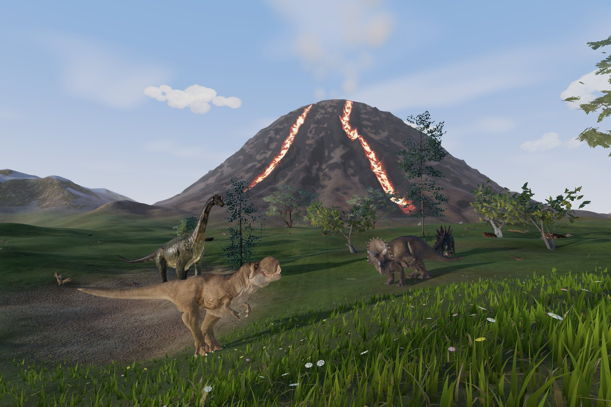
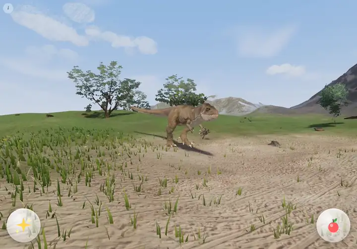
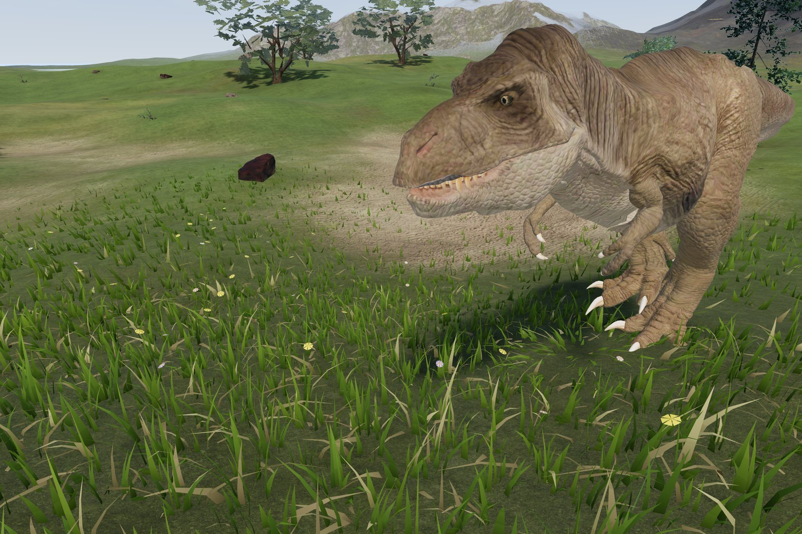
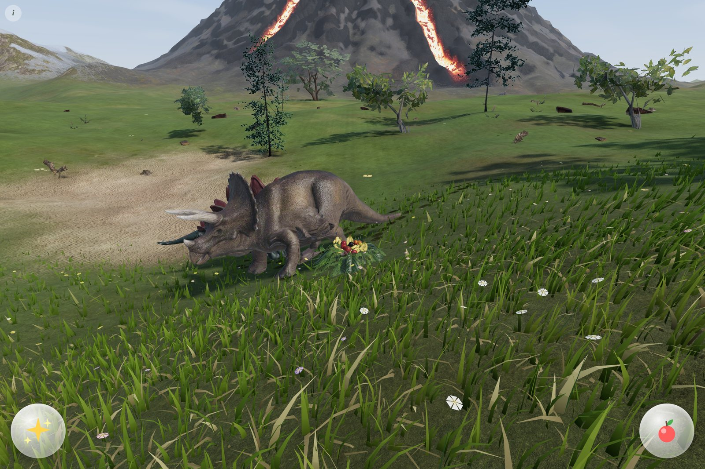
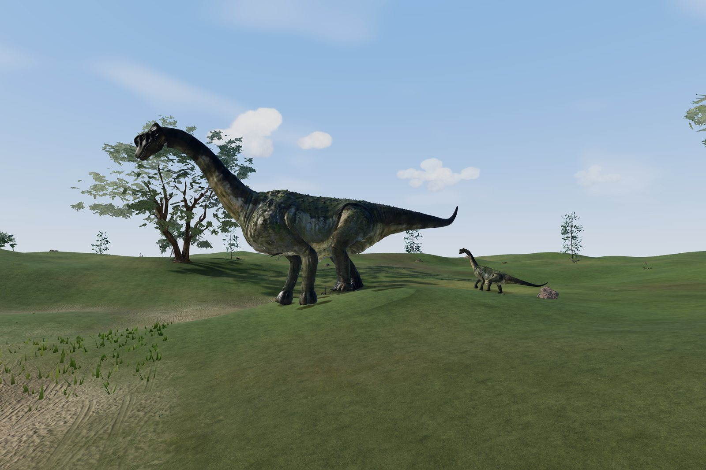
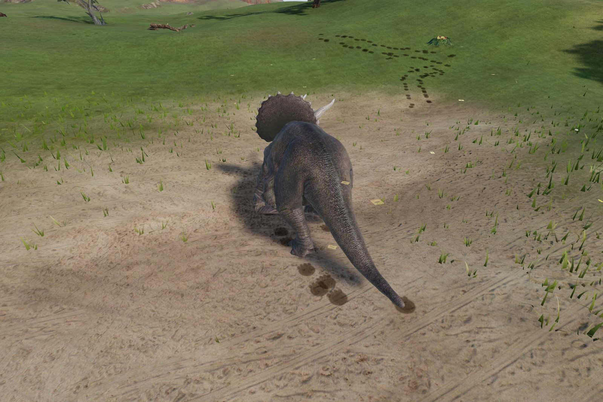
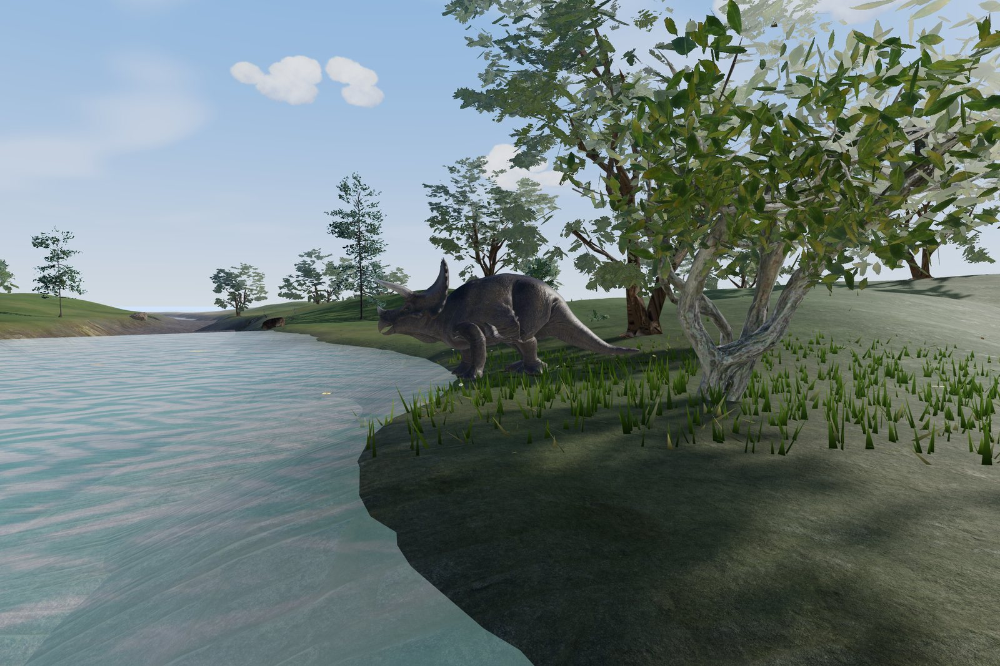
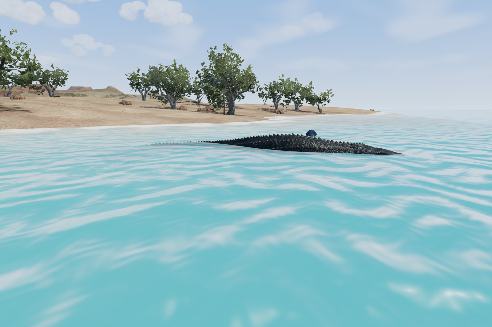
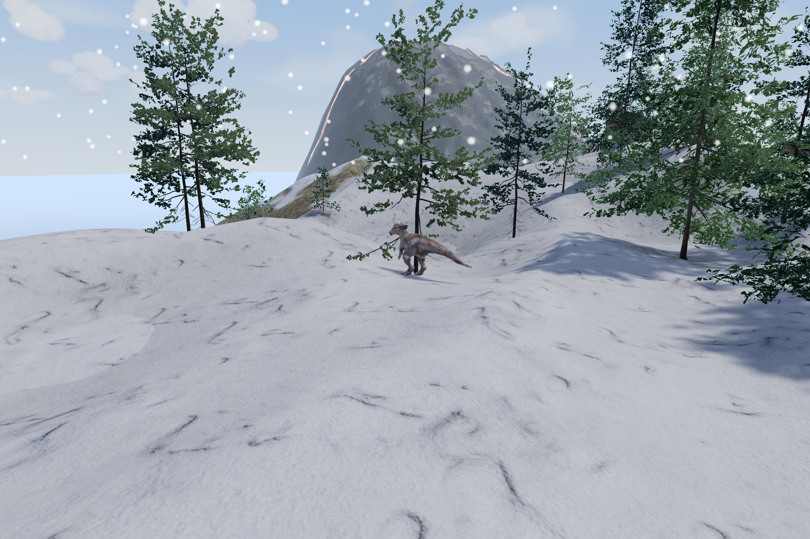
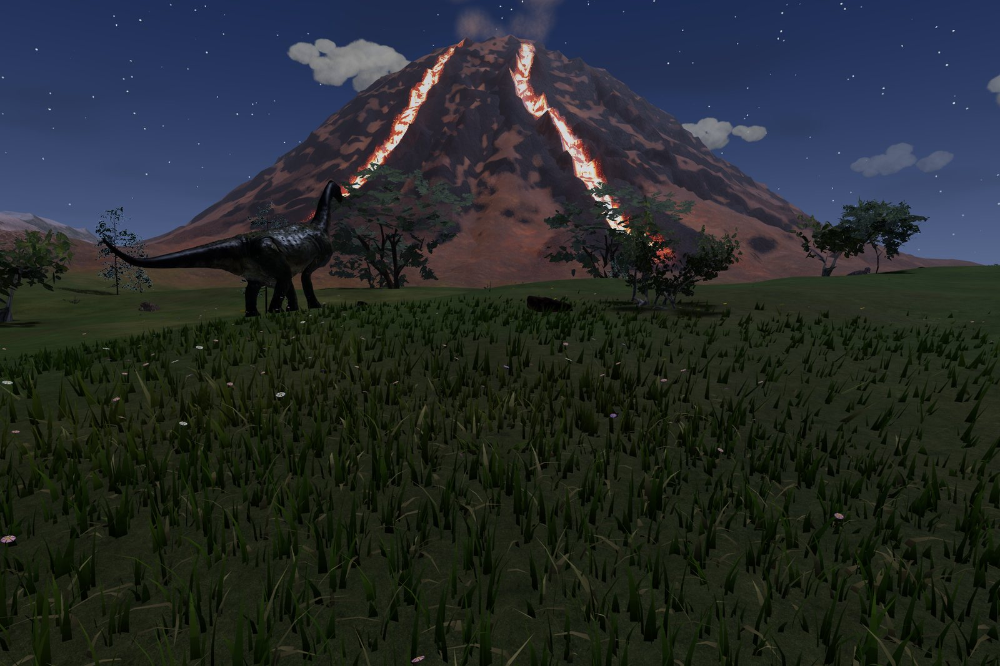

<h1 align="center">Dino Pals</h1>

<p align="center"><b>A dinosaur island for a three-year-old. No rules, no score, no reading.</b><br>
Tap the ground to walk. Tap a dinosaur to say hello. Drop some fruit and watch them eat.</p>

<p align="center">
  <a href="https://dino-pals-ai-learning-center.vercel.app"><b>Play it in the browser</b></a> ·
  <a href="docs/media/dino-pals-demo.mp4"><b>Watch the 67-second demo</b></a> ·
  <a href="LOG.md">Build log</a>
</p>

<p align="center"></p>

Dino Pals is a touch-first, open-world dinosaur sandbox made for one small explorer who plays on an iPad.
There is nothing to win and nothing to fail. The world is a living island: dinosaurs wander, graze,
drink at the river, sleep at night and come over to say hello when you tap them. It runs in Safari, with
nothing to install, as a web app built on three.js.

<p align="center"></p>
<p align="center"><sub>A short preview. The full 67-second demo (30 fps, no sound) is <a href="docs/media/dino-pals-demo.mp4">docs/media/dino-pals-demo.mp4</a>.</sub></p>

## How a three-year-old plays

| Do this | And this happens |
|---|---|
| Tap the ground | Your explorer walks there, with a little sparkle |
| Tap a dinosaur | It turns to you, roars (real animal recordings) and its name is spoken |
| Tap it again | Its own second trick: a stomp, a sniff, a graze, a swoop or a splash |
| Hold a dinosaur | It follows you around, walking beside you where you can see it |
| Tap the apple | A pile of fruit and leaves drops in front of you, and the plant-eaters come to eat it one bite at a time |
| Tap the sparkle | The time of day jumps ahead: sunrise, noon, sunset, a starry night |
| Drag, pinch | Look around, zoom in and out |

Taps never break anything. Rapid tapping queues the next action instead of interrupting the current
one, and palm-mashing, multi-finger chaos and long holds were all stress-tested.

## A tour of the island

<table>
<tr>
<td width="50%"><br><sub><b>Say hello.</b> A tapped T. rex turns to face you and roars.</sub></td>
<td width="50%"><br><sub><b>Feeding time.</b> Plant-eaters walk to the pile, line up their mouths and eat it piece by piece.</sub></td>
</tr>
<tr>
<td><br><sub><b>Families.</b> Babies stay at their parent's side, graze when it grazes and echo its calls.</sub></td>
<td><br><sub><b>Footprints.</b> Every planted foot presses a print into sand, mud or snow.</sub></td>
</tr>
<tr>
<td><br><sub><b>A drink at the river.</b> Now and then an animal walks to the water's edge to drink, or wades through the shallows.</sub></td>
<td><br><sub><b>The sea.</b> Marine reptiles patrol the bays, and pterosaurs swoop low over the meadows.</sub></td>
</tr>
<tr>
<td><br><sub><b>Snowy forest.</b> Eight biomes: meadow, jungle, volcano, beach, swamp, snow, canyon and lake.</sub></td>
<td><br><sub><b>Night.</b> Lava lights the volcano, dinosaurs settle down to sleep and snore, and wake with a yawn at dawn.</sub></td>
</tr>
</table>

## What makes it feel alive

- **Real walking, not sliding.** Feet are planted in the world and the legs are solved with inverse kinematics every frame. Stride and timing follow animal biomechanics (stride length from the Froude number, walk-to-trot blending), turns are made by stepping, and the hips, tail and head move with the gait. Measured foot slip while walking is about 1 cm.
- **Bodies that don't pass through things.** Every animal steers with velocity obstacles around trees, rocks, the explorer and each other, and plans routes with A*. Long automated play sessions, including minutes of random toddler input, record zero overlaps.
- **Eating that actually reaches the food.** Each animal picks one item, stands where its mouth can reach it, lowers its neck onto it with IK and bites. The piece flies into its mouth and the pile shrinks. Median distance from mouth to item at the bite: about 5 cm.
- **Idle life.** Standing animals breathe, shift their weight, swish their tails, take fidget steps and glance around instead of staring.
- **Detailed assets.** 15 rigged, animated dinosaurs; real-leaf trees and conifers baked from modelled needles; photoscanned ground, rocks and food; dense wind-blown grass that parts around feet; recorded animal voices and birdsong.

## Built for an iPad

- Plays in Safari, and full screen when added to the home screen. GPU-compressed textures (KTX2: ASTC on iPad) keep the whole island within roughly 230 MB of graphics memory.
- A resolution governor keeps the frame rate steady on older or hot iPads, and the low-detail tier switches in automatically.
- It survives the things iPads do: the 3D view being dropped in the background, audio interrupted by calls and Siri, the screen going to sleep mid-game.
- Every data file is content-hashed, so an update is never hidden behind a stale cache.

### For grown-ups

- **Full screen:** open the site in Safari, tap Share, then *Add to Home Screen*, and launch Dino Pals from its icon.
- **Keep little hands in the game:** Settings, Accessibility, turn on *Guided Access*; open Dino Pals and triple-click the top (or Home) button.
- **Grown-up panel** (credits, reset position, these tips): hold the small *i* in the top-left corner for two seconds.

## Under the hood

| Part | What it is |
|---|---|
| `web/` | Vite + TypeScript + three.js (r186) app, deployed to Vercel as a static site |
| `web/src/dinos/` | Procedural locomotion (IK legs, gait clock, pelvis and tail dynamics), steering and route planning, feeding, behaviour |
| `web/src/world/` | Procedural 1.5 km island: terrain, biomes, vegetation streaming and LOD, grass, water, sky and weather, food, footprints |
| `blender/` | Headless Blender 5 pipeline: cleans each source model, auto-rigs it from a voxelised body (spine, legs, jaw, geodesic skin weights) and bakes idle, walk, roar and eat clips |
| `web/scripts/` | Environment fetch and bake (Poly Haven), conifer needle-card baker, texture compression |
| `web/tests/` | Playwright test and filming suite (below) |
| `LOG.md` | Every decision, bug and measurement, in order |

### Run it

```bash
cd web
npm install
npm run dev          # http://localhost:5173
npm run build        # production build in web/dist
```

### Tests

Run from `web/` after `npm run build`. They drive headless Chromium with the GPU (and WebKit, Safari's engine) on an iPad-sized touch viewport:

| Command | Checks |
|---|---|
| `npm run test:mobile` | Build, then check real phone/tablet taps in Chromium and WebKit; pending audio/fullscreen permissions, pinch/cancel/hold recovery, buttons, rotation and scrolling the parent panel |
| `node tests/smoke.mjs` | Every biome, both quality tiers, portrait, touch gestures, zero errors |
| `node tests/webkit_smoke.mjs`, `node tests/visual_parity.mjs` | The Safari engine: errors, and the same frames rendered in Chromium and WebKit |
| `node tests/gait.mjs`, `node tests/smooth.mjs` | Foot slip and IK reach per species; per-frame jolts, hip dips and sideways sliding |
| `node tests/collide.mjs`, `node tests/eat.mjs`, `node tests/forest_cross.mjs` | No overlaps with trees or each other; bites land in the mouth; animals can cross the forest |
| `node tests/monkey.mjs`, `node tests/spam.mjs` | Minutes of random toddler input; rapid taps |
| `node tests/lifecycle.mjs`, `node tests/governor.mjs`, `node tests/leak.mjs`, `node tests/texmem.mjs` | iPad lifecycle, adaptive resolution, long-session memory, GPU texture budget |
| `BASE=https://… node tests/prod.mjs` | Post-deploy check against the live site |
| `node tests/reel.mjs`, `node tests/readme_shots.mjs` | Render the demo video and these screenshots |

### Rebuild the assets

```bash
blender/run_all.sh <dir-with-source-glbs> --preview   # rig, animate, export, QA renders
blender/postprocess.sh                                # Draco + KTX2 into web/public/assets/dinos
python3 blender/manifest.py                           # species manifest + attribution
cd web && node scripts/fetch-env.mjs                  # environment from Poly Haven (conifers baked from modelled needles)
```

## Credits

**Dinosaur models.** Each is a Creative Commons Attribution 4.0 work, re-rigged and animated for this project. Thank you to their authors:

| Species | Kind | Source model | License |
|---|---|---|---|
| Tyrannosaurus rex | land | [Tyrannosaurus Rex](https://sketchfab.com/3d-models/a3384b114989470fb60f0500aeaae903) by Arion Digital | CC BY 4.0 |
| Triceratops | land | [Triceratops Horridus](https://sketchfab.com/3d-models/cb7bad2c70dc4748a9c58ef9db5fce5e) by IagoMendez | CC BY 4.0 |
| Stegosaurus | land | [Stegosaurus](https://sketchfab.com/3d-models/b2545ed6031e49939b823b1c8435989e) by PAndras | CC BY 4.0 |
| Paluxysaurus | land | [Paluxysaurus](https://sketchfab.com/3d-models/afb6b5c7221b4f43a40762cdd9cdf90c) by Julian Johnson-Mortimer | CC BY 4.0 |
| Velociraptor | land | [Velociraptor](https://sketchfab.com/3d-models/b227da6c817043ab9a249dbbd127db67) by Tomas Ibar | CC BY 4.0 |
| Sauropelta | land | [Sauropelta](https://sketchfab.com/3d-models/da2bc6ed57404f9f8ed56a975d674b2a) by Julian Johnson-Mortimer | CC BY 4.0 |
| Ankylosaurus | land | [Ankylosaurus](https://sketchfab.com/3d-models/163daf7cc0664671b017ea874766e809) by InaLaAtzu | CC BY 4.0 |
| Iguanodon | land | [Iguanodon](https://sketchfab.com/3d-models/2dae61d169e346829b85998526091107) by Digital3dWorld | CC BY 4.0 |
| Ornithocheirus | flying reptile | [Ornithocheirus](https://sketchfab.com/3d-models/02d6ca0e98db474fa307b877ad2db90b) by Digital3dWorld | CC BY 4.0 |
| Spinosaurus | land | [Spinosaurus](https://sketchfab.com/3d-models/4f2332ee93874d59a55fb60ed2873ec2) by Julian Johnson-Mortimer | CC BY 4.0 |
| Carnotaurus | land | [CARNOTAURUS](https://sketchfab.com/3d-models/ab2350d7cd7e4727ad6052edfceb35c9) by Cenker Turhan | CC BY 4.0 |
| Allosaurus | land | [Allosaurus](https://sketchfab.com/3d-models/6c5142e093a147bdb86e0eeb837b476c) by PAndras | CC BY 4.0 |
| Pachycephalosaurus | land | [Pachycephalosaurus_animation](https://sketchfab.com/3d-models/740349873ae244ef8a19155b525d9193) by seirogan | CC BY 4.0 |
| Pistosaurus | marine reptile | [Pistosaur Animated](https://sketchfab.com/3d-models/773667575a264c7baa4ec404115a044b) by ricksticky | CC BY 4.0 |
| Mosasaurus | marine reptile | [mosasaurus](https://sketchfab.com/3d-models/6c343575d0df414aba162c69ac1f0105) by Epic_devolepment | CC BY 4.0 |

**Environment.** Trees, plants, rocks, ground textures and the fruit pile are from [Poly Haven](https://polyhaven.com), CC0. The full per-asset list is in `web/public/assets/env/credits.json` and in the in-app grown-up panel.

**Animal voices and birdsong.** Real recordings from Wikimedia Commons (public domain or CC0), pitched and edited into dinosaur voices by `audio/build_voices.py`:

<details><summary>Recording sources (20)</summary>

- [Alligatorbellow1.ogg](https://commons.wikimedia.org/wiki/File:Alligatorbellow1.ogg) · unknown author · Public domain
- [Alligatorbellowedit.ogg](https://commons.wikimedia.org/wiki/File:Alligatorbellowedit.ogg) · Borisblue · Public domain
- [27alligator2bellow.ogg](https://commons.wikimedia.org/wiki/File:27alligator2bellow.ogg) · unknown author · Public domain
- [Elephant voice - trumpeting.ogg](https://commons.wikimedia.org/wiki/File:Elephant_voice_-_trumpeting.ogg) · தகவலுழவன் · CC0
- [Bison.wav](https://commons.wikimedia.org/wiki/File:Bison.wav) · National Park Service · Public domain
- [Cow in Antefasy.wav](https://commons.wikimedia.org/wiki/File:Cow_in_Antefasy.wav) · Gasybeaugosse2020 · CC0
- [Great Blue Heron.ogg](https://commons.wikimedia.org/wiki/File:Great_Blue_Heron.ogg) · unknown author · Public domain
- [Pavo cristatus (call).ogg](https://commons.wikimedia.org/wiki/File:Pavo_cristatus_(call).ogg) · Ke4roh · Public domain
- [Gobbler.ogg](https://commons.wikimedia.org/wiki/File:Gobbler.ogg) · bod · Public domain
- [Yellowstone sound library - Sandhill Crane - 001.mp3](https://commons.wikimedia.org/wiki/File:Yellowstone_sound_library_-_Sandhill_Crane_-_001.mp3) · NPS & MSU Acoustic Atlas / Jennifer Jerrett · Public domain
- [Gull 2.ogg](https://commons.wikimedia.org/wiki/File:Gull_2.ogg) · avphillips · Public domain
- [Humpback whale wheezeblow.ogg](https://commons.wikimedia.org/wiki/File:Humpback_whale_wheezeblow.ogg) · National Park Service · Public domain
- [Yellowstone sound library - Mountain Bluebird - 001.mp3](https://commons.wikimedia.org/wiki/File:Yellowstone_sound_library_-_Mountain_Bluebird_-_001.mp3) · NPS & MSU Acoustic Atlas/Jennifer Jerrett · Public domain
- [Yellowstone sound library - Red-Winged Blackbird - 001.mp3](https://commons.wikimedia.org/wiki/File:Yellowstone_sound_library_-_Red-Winged_Blackbird_-_001.mp3) · NPS & MSU Acoustic Atlas / Jennifer Jerrett · Public domain
- [LaughingKookaburra.ogg](https://commons.wikimedia.org/wiki/File:LaughingKookaburra.ogg) · Kuco · Public domain
- [Yellow-tailed Black Cockatoos.ogg](https://commons.wikimedia.org/wiki/File:Yellow-tailed_Black_Cockatoos.ogg) · Wardie44 · Public domain
- [Yellowstone sound library - Common Loon - 001.mp3](https://commons.wikimedia.org/wiki/File:Yellowstone_sound_library_-_Common_Loon_-_001.mp3) · NPS & MSU Acoustic Atlas/Jennifer Jerrett · Public domain
- [Yellowstone sound library - Canada Geese - 001.mp3](https://commons.wikimedia.org/wiki/File:Yellowstone_sound_library_-_Canada_Geese_-_001.mp3) · NPS & MSU Acoustic Atlas / Jennifer Jerrett · Public domain
- [XC707075 - European Herring Gull - Larus argentatus.mp3](https://commons.wikimedia.org/wiki/File:XC707075_-_European_Herring_Gull_-_Larus_argentatus.mp3) · Sonothèque ADVL · CC0
- [Gull 1.ogg](https://commons.wikimedia.org/wiki/File:Gull_1.ogg) · avphillips · Public domain

</details>

**Engine.** [three.js](https://threejs.org) (MIT), [Vite](https://vitejs.dev) (MIT), [glTF-Transform](https://gltf-transform.dev) (MIT), [Basis Universal](https://github.com/BinomialLLC/basis_universal) (Apache 2.0), [Draco](https://github.com/google/draco) (Apache 2.0). Music and sound effects are synthesized in the browser.

## License

The code is released under the [MIT License](LICENSE). The bundled third-party assets keep their own licenses, listed under Credits above and in [THIRD_PARTY_NOTICES.md](THIRD_PARTY_NOTICES.md): the dinosaur models are CC BY 4.0 (please keep the attributions), the environment is CC0, and the animal recordings are public domain or CC0.

<p align="center"><sub>Made with love for one small explorer.</sub></p>
